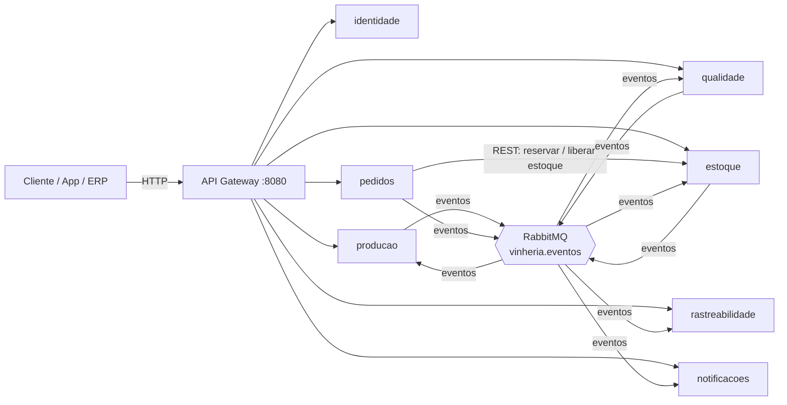

# 🍷 Vinheria — Plataforma de Microsserviços

Projeto de estudo/portfólio que simula o back-end de uma vinícola: **produção de lotes, controle de qualidade, rastreabilidade, estoque, pedidos e notificações**.
Baseado na proposta de arquitetura do documento *"Arquitetura de Microsserviços para uma Vinheria"*.

**Stack:** Java 21 · Spring Boot 3.3 · Spring Security + JWT · Spring Data JPA · PostgreSQL · RabbitMQ · Spring Cloud Gateway · Docker Compose

---

## 1. Visão geral



Cada serviço tem **seu próprio banco** (*Database per Service*): `identidade_db`, `producao_db`, `qualidade_db`, `estoque_db`, `pedidos_db`, `rastreabilidade_db`, `notificacoes_db`. Nenhum serviço lê o banco do outro.

## 2. Microsserviços

| Serviço | Porta | Responsabilidade | REST (via gateway) | Publica | Consome |
|---|---|---|---|---|---|
| **api-gateway** | 8080 | Ponto único de entrada; roteia por caminho. Sem regra de negócio. | — | — | — |
| **identidade** | 8081 | Usuários, login, **emissão do JWT**, papéis. | `POST /auth/login`, `POST /auth/registro`, `GET /api/usuarios/me`, `GET /api/usuarios` | — | — |
| **producao** | 8082 | Lotes e etapas (colheita → fermentação → maturação → engarrafamento); quarentena. | `POST/GET /api/lotes`, `POST /api/lotes/{codigo}/etapas/concluir` | `lote.criado`, `lote.etapa-concluida`, `lote.engarrafado` | `qualidade.aprovada`, `qualidade.reprovada` |
| **qualidade** | 8083 | Análises laboratoriais e regras de aprovação (pH, acidez, álcool, temperatura). | `POST/GET /api/analises` | `qualidade.aprovada`, `qualidade.reprovada` | `lote.criado` |
| **estoque** | 8084 | Saldo de garrafas, reservas e alerta de estoque baixo. | `GET/POST /api/produtos`, `POST /api/reservas`, `DELETE /api/reservas/{pedidoId}` | `estoque.baixo` | `lote.engarrafado` |
| **pedidos** | 8085 | Pedidos de venda e a Saga de reserva/cancelamento. | `POST/GET /api/pedidos`, `PATCH /api/pedidos/{id}/cancelar` | `pedido.confirmado`, `pedido.cancelado` | — |
| **rastreabilidade** | 8086 | Linha do tempo (histórico auditável) de cada lote. | `GET /api/rastreabilidade/lotes/{codigo}` | — | `lote.*`, `qualidade.*` |
| **notificacoes** | 8087 | Transforma eventos em notificações (e-mail simulado). | `GET /api/notificacoes` | — | `pedido.*`, `estoque.baixo`, `qualidade.reprovada` |

## 3. REST × RabbitMQ: quando usar cada um

A regra aplicada (a mesma do PDF): **REST quando quem chama precisa da resposta para continuar; evento quando a reação pode acontecer depois ou há vários interessados.**

| Situação | Mecanismo | Por quê |
|---|---|---|
| Pedidos → Estoque: reservar itens | **REST** (síncrono) | O pedido só pode ser confirmado ou recusado depois de saber se há saldo; a resposta também traz o preço. |
| Pedidos → Estoque: liberar reserva ao cancelar | **REST** (síncrono) | É a compensação da Saga; se falhar, o pedido **não** é cancelado (evita inconsistência). |
| Qualidade reprova lote → Produção coloca em **quarentena** | **Evento** `qualidade.reprovada` | Qualidade não precisa conhecer a Produção; vários serviços reagem ao mesmo fato (Produção, Notificações, Rastreabilidade). |
| Produção engarrafa → Estoque dá **entrada** das garrafas | **Evento** `lote.engarrafado` | A produção não deve ficar bloqueada nem falhar se o estoque estiver fora do ar; a mensagem espera na fila. |
| Qualquer mudança de lote → **Rastreabilidade** | **Evento** `lote.*` / `qualidade.*` | Um serviço novo pode ouvir os mesmos eventos sem alterar quem publica. |
| Pedido confirmado/cancelado, estoque baixo → **Notificações** | **Evento** | Envio de e-mail é lento e falho por natureza; nunca deve atrasar ou derrubar a criação do pedido. |
| Produção cria lote → Qualidade "conhece" o lote | **Evento** `lote.criado` | Qualidade guarda uma cópia mínima do código do lote e valida análises sem chamar a Produção. |

**Topologia RabbitMQ:** um *topic exchange* `vinheria.eventos`. Cada consumidor cria sua própria fila (ex.: `estoque.lote-engarrafado`) ligada às routing keys de interesse. Falhas são tentadas 3x com backoff exponencial (1s, 2s) e depois vão para a **Dead Letter Queue** `vinheria.eventos.dlq` (veja no painel `http://localhost:15672`).

## 4. Segurança

- **identidade** valida usuário/senha (BCrypt) e emite um **JWT HS256** com `sub` (username), `roles` e expiração (1h).
- Todos os outros serviços são *resource servers* (Spring Security): validam assinatura e expiração do token e aplicam `@PreAuthorize` por papel.
- Pedidos repassa o JWT do cliente ao Estoque; cada serviço autoriza por conta própria.

| Papel | Pode |
|---|---|
| `ADMIN` | tudo (incluindo cadastrar produtos e ver notificações) |
| `OPERADOR` | criar lotes e concluir etapas; consultar lotes, análises e histórico |
| `LABORATORIO` | registrar análises; consultar lotes, análises e histórico |
| `CLIENTE` | criar/ver/cancelar **seus próprios** pedidos; consultar produtos |

Usuários de demonstração: `admin/admin123`, `operador/operador123`, `laboratorio/lab123`, `cliente/cliente123`.

## 5. Como executar

Requisitos: Docker e Docker Compose.

```bash
docker compose up --build
```

Aguarde os serviços subirem (a primeira build baixa dependências do Maven e leva alguns minutos). API em `http://localhost:8080`; painel RabbitMQ em `http://localhost:15672` (`vinheria` / `vinheria`).

Para trocar o segredo do JWT: copie `.env.example` para `.env` e edite `JWT_SECRET` (mínimo 32 caracteres).

Testes unitários de cada serviço: `cd services/<servico> && mvn test` (precisa de JDK 21 e Maven).

## 6. Roteiro de teste (curl)

> Usa `jq` para extrair o token. Sem `jq`, copie o `accessToken` da resposta manualmente.

```bash
API=http://localhost:8080
login() { curl -s -X POST $API/auth/login -H 'Content-Type: application/json' \
          -d "{\"username\":\"$1\",\"senha\":\"$2\"}" | jq -r .accessToken; }

ADMIN=$(login admin admin123); OPERADOR=$(login operador operador123)
LAB=$(login laboratorio lab123); CLIENTE=$(login cliente cliente123)
```

### A) Fluxo de pedido (REST + Saga + eventos)
```bash
# Catálogo (seed: CAB-2025-750 com 20 un., mínimo 5)
curl -s $API/api/produtos -H "Authorization: Bearer $CLIENTE" | jq

# Pedido de 16 unidades -> CONFIRMADO; disponível cai para 4 (<= mínimo) e dispara 'estoque.baixo'
curl -s -X POST $API/api/pedidos -H "Authorization: Bearer $CLIENTE" -H 'Content-Type: application/json' \
  -d '{"itens":[{"sku":"CAB-2025-750","quantidade":16}]}' | jq

# Novo pedido de 10 unidades -> status RECUSADO (estoque insuficiente)
curl -s -X POST $API/api/pedidos -H "Authorization: Bearer $CLIENTE" -H 'Content-Type: application/json' \
  -d '{"itens":[{"sku":"CAB-2025-750","quantidade":10}]}' | jq

# Cancelar o pedido 1 -> compensação: reserva liberada no estoque
curl -s -X PATCH $API/api/pedidos/1/cancelar -H "Authorization: Bearer $CLIENTE" | jq

# Notificações geradas de forma assíncrona (pedido confirmado, estoque baixo, pedido cancelado)
curl -s $API/api/notificacoes -H "Authorization: Bearer $ADMIN" | jq
```

### B) Fluxo de produção e qualidade (eventos)
```bash
# 1. Operador cria o lote (publica lote.criado)
curl -s -X POST $API/api/lotes -H "Authorization: Bearer $OPERADOR" -H 'Content-Type: application/json' \
  -d '{"codigo":"L2025-001","uva":"Cabernet Sauvignon","safra":2025,"fornecedorUva":"Fazenda Serra Azul",
       "quantidadeKg":1500,"sku":"CAB-2025-750","nomeProduto":"Cabernet Sauvignon 2025 750ml"}' | jq

# 2. Laboratório REPROVA (pH 4.2) -> lote vai para EM_QUARENTENA
curl -s -X POST $API/api/analises -H "Authorization: Bearer $LAB" -H 'Content-Type: application/json' \
  -d '{"loteCodigo":"L2025-001","ph":4.2,"acidezTotal":6.0,"teorAlcoolico":13.0,"temperaturaC":22}' | jq
curl -s $API/api/lotes/L2025-001 -H "Authorization: Bearer $OPERADOR" | jq .status      # "EM_QUARENTENA"

# 3. Tentar avançar etapa em quarentena -> 409
curl -s -X POST $API/api/lotes/L2025-001/etapas/concluir -H "Authorization: Bearer $OPERADOR" | jq

# 4. Nova análise APROVADA -> lote liberado
curl -s -X POST $API/api/analises -H "Authorization: Bearer $LAB" -H 'Content-Type: application/json' \
  -d '{"loteCodigo":"L2025-001","ph":3.4,"acidezTotal":6.0,"teorAlcoolico":13.0,"temperaturaC":22}' | jq

# 5. Concluir 4 etapas; na última informe as garrafas (-> Estoque recebe a entrada por evento)
for i in 1 2 3; do curl -s -X POST $API/api/lotes/L2025-001/etapas/concluir -H "Authorization: Bearer $OPERADOR" > /dev/null; done
curl -s -X POST $API/api/lotes/L2025-001/etapas/concluir -H "Authorization: Bearer $OPERADOR" \
  -H 'Content-Type: application/json' -d '{"quantidadeGarrafas":120}' | jq
curl -s $API/api/produtos/CAB-2025-750 -H "Authorization: Bearer $OPERADOR" | jq        # saldo aumentou em 120

# 6. Linha do tempo completa do lote
curl -s $API/api/rastreabilidade/lotes/L2025-001 -H "Authorization: Bearer $OPERADOR" | jq
```

### C) Segurança
```bash
curl -i $API/api/lotes                                                     # 401 (sem token)
curl -i $API/api/notificacoes -H "Authorization: Bearer $CLIENTE"          # 403 (papel insuficiente)
```

### D) Ver resiliência em ação
- `docker compose stop estoque-service` → crie um pedido: ele é **RECUSADO** com o motivo "estoque indisponível" (timeout/conexão).
- Com o estoque parado, conclua o engarrafamento de um lote: o evento `lote.engarrafado` **fica na fila**; ao fazer `docker compose start estoque-service`, a entrada é processada.
- Cadastre um lote com SKU inexistente (ex.: `"sku":"XYZ"`) e conclua o engarrafamento: após 3 tentativas a mensagem vai para a **DLQ**.

## 7. Alinhamento com o PDF

| Padrão / prática do PDF | Neste projeto |
|---|---|
| Microsserviços por domínio | ✅ Identidade, Produção, Qualidade, Rastreabilidade, Estoque, Pedidos, Notificações |
| API Gateway | ✅ Spring Cloud Gateway (somente roteamento) |
| Service Discovery | ✅ Via DNS do Docker Compose (o PDF aceita DNS do orquestrador; sem Eureka) |
| Database per Service | ✅ Um banco e um usuário por serviço (na mesma instância PostgreSQL, por economia de recursos) |
| Saga | ✅ Orquestrada em Pedidos: reservar → confirmar; cancelar → compensar (libera reserva) |
| Event-Driven | ✅ RabbitMQ, consumidores idempotentes, retry com backoff e DLQ |
| JWT / RBAC / TLS | ✅ JWT + papéis. ⚠️ TLS não configurado (em produção, termina no gateway/proxy) |
| Estado explícito (PENDENTE, CONFIRMADO, EM_QUARENTENA...) | ✅ |
| Timeout em chamadas síncronas | ✅ RestClient com timeouts de conexão e leitura |
| Rastreabilidade com histórico imutável | ✅ Tabela append-only alimentada por eventos |

### Simplificações conscientes (o que ficou de fora e por quê)
- **Outbox Pattern (versão simplificada):** os eventos são publicados *após o commit* da transação, o que evita anunciar algo que sofreu rollback. Resta uma janela pequena (banco commitou, mas o broker caiu antes do envio). A versão completa grava o evento em uma tabela e um *publisher* o envia depois — o próximo passo natural.
- **Circuit Breaker / Retry em chamadas REST:** apenas timeouts. Seria o próximo passo (Resilience4j) se houvesse muitas chamadas síncronas.
- **Fornecedores/Compras, Relatórios/CQRS:** domínios opcionais/futuros no PDF; o próprio documento recomenda começar por Produção, Qualidade, Rastreabilidade e Estoque.
- **Expedição:** o pedido termina em CONFIRMADO/CANCELADO; a baixa definitiva do saldo na expedição não foi modelada.
- **JWT com chave simétrica (HS256):** simples para estudo. Em produção, use chave assimétrica ou um provedor OIDC (Keycloak).
- **Schema com `ddl-auto: update`:** troque por Flyway/Liquibase em produção.
- **Sem OpenAPI, tracing distribuído ou métricas:** o PDF os recomenda para governança; ficam como evolução (springdoc-openapi, OpenTelemetry).
- **Consistência eventual:** logo após criar um lote, a Qualidade pode levar milissegundos para "conhecê-lo"; uma análise imediata pode retornar 404 — comportamento esperado em arquitetura orientada a eventos.

## 8. Estrutura

```
vinheria/
├── docker-compose.yml
├── infra/postgres/init.sql          # um banco/usuário por serviço
├── .env.example
└── services/
    ├── api-gateway/
    ├── identidade-service/          # cada serviço: pom.xml, Dockerfile e src/
    ├── producao-service/
    ├── qualidade-service/
    ├── estoque-service/
    ├── pedidos-service/
    ├── rastreabilidade-service/
    └── notificacoes-service/
```

Organização interna padrão de cada serviço (por funcionalidade, sem camadas excessivas):
`controller → service → repository`, DTOs como `record`, regras de negócio dentro das entidades quando fazem sentido (`Lote.concluirEtapa`, `Produto.reservar`), pacotes `config/` (segurança e RabbitMQ) e `messaging/` (eventos e listeners).

## 9. Ideias para evoluir (portfólio)
1. Implementar o Outbox completo em Pedidos.
2. Adicionar Resilience4j (Circuit Breaker) no `EstoqueClient`.
3. Testes de integração com Testcontainers (PostgreSQL + RabbitMQ).
4. Documentar as APIs com springdoc-openapi.
5. Criar o serviço de Fornecedores/Compras publicando `compra.recebida` (entrada de insumos no Estoque).
6. Observabilidade com OpenTelemetry + Grafana.
